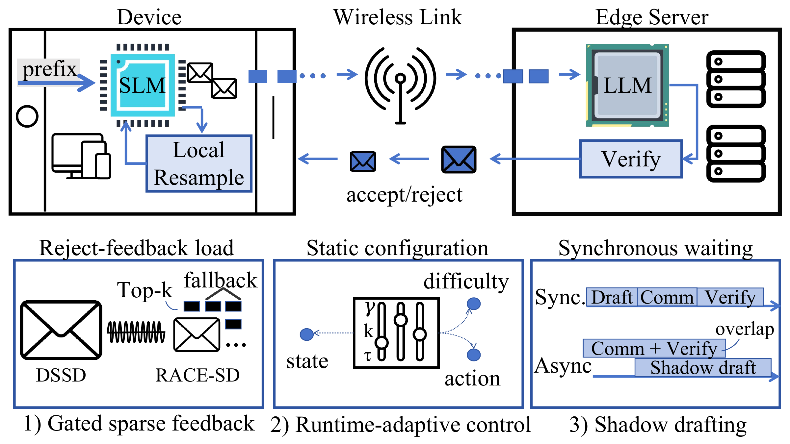

<div align="center">

# RACE-SD

### Runtime-Adaptive and Communication-Efficient Speculative Decoding for Edge LLM Inference

[Overview](#overview) · [Method](#method) · [Installation](#installation) · [Quick Start](#quick-start) · [Code Structure](#code-structure)

</div>

## Overview

RACE-SD studies speculative decoding with a lightweight draft model on a resource-constrained device and a target model on an edge server. In this setting, each decoding round requires bidirectional communication. Vocabulary-scale rejection feedback, fixed speculation settings, and synchronous device waiting can offset the benefit of parallel target-model verification.

RACE-SD coordinates **sparse rejection feedback**, **network-aware online control**, and **asynchronous shadow drafting** to improve end-to-end decoding throughput. The controller adapts the draft length and feedback configuration to acceptance behavior, prediction uncertainty, and observed link conditions. Shadow drafting uses otherwise idle time to prepare candidates for the next round.

<p align="center">
  
</p>
<p align="center"><em>System overview and the three coordinated mechanisms of RACE-SD.</em></p>

This repository contains the implementation, experiment runners, diagnostic utilities, unit tests, and the method illustration. Model checkpoints, prompt datasets, measured network traces, experiment outputs, and manuscript files are not included.

## Method

### 1. Gated sparse rejection feedback

At the first rejected token, the edge server retains the top-$k$ entries of the target distribution. It sends a sparse packet only when their total probability meets a threshold $\tau$; otherwise, it falls back to full rejection feedback. The device combines the returned target probabilities with its locally retained draft distribution for residual resampling.

Sparse feedback introduces an approximation to the residual distribution. The threshold and fallback control truncation; they do not by themselves guarantee exact target-distribution sampling. The repository includes residual-distortion diagnostics for this reason.

### 2. Network-aware online control

At round $t$, the controller selects

$$a_t=(\gamma_t,c_t,k_t,\tau_t),$$

where $\gamma_t$ is the draft length, $c_t$ enables sparse feedback, $k_t$ is the retained support size, and $\tau_t$ is the retained-probability threshold. Candidate actions are evaluated using estimates of accepted progress and computation/communication cost. Warm-up, hysteresis, minimum residency, and a conservative fallback stabilize online decisions. The default batch configuration exposes link observations from completed rounds to the controller.

### 3. Asynchronous shadow drafting

While the current round is being transmitted and verified, the device may prepare the next draft if its estimated benefit is positive. The speculative result is reused only when the current candidates are all accepted and the predicted anchor token matches the returned token. Otherwise, the shadow result is discarded. The implementation keeps separate random-number streams for foreground and shadow execution.

The supplied runner executes the draft and target models in one process on configurable devices. Communication is represented by packet-size-dependent link delays, with optional time-varying trace replay. It is a research evaluation implementation, not a networked client/server deployment.

## Installation

Use Python 3.12 and a PyTorch build appropriate for your CPU/CUDA environment. The recorded research environment used PyTorch 2.9.0 and Transformers 5.8.1; the corresponding Python package versions are listed in `requirements.txt`.

```bash
git clone https://github.com/wangshilin-2004/RACE-SD.git
cd RACE-SD
python3 -m venv .venv
source .venv/bin/activate
python -m pip install -r requirements.txt
```

Prepare a compatible draft/target model pair with the same token vocabulary. The experiment scripts support local Hugging Face model directories. Model access and checkpoint downloads must be arranged separately.

## Quick Start

### Prepare inputs

Create your own JSONL prompt file. Each line has a `text` field and an optional `source` field used to group workloads. For example:

```json
{"source": "example", "text": "Explain how speculative decoding reduces inference latency."}
```

Save your inputs outside version control, for example as `data/prompts.jsonl`. This illustrative prompt is not part of the evaluation dataset.

### Run RACE-SD

The method is selected with the existing CLI identifier `async_sd`:

```bash
python batch_experiments.py \
  --prompt-file data/prompts.jsonl \
  --draft-model /path/to/draft-model \
  --target-model /path/to/target-model \
  --device-draft cpu \
  --device-target cuda:0 \
  --methods async_sd \
  --bandwidth 100 \
  --rtt-ms 20 \
  --max-len 80 \
  --output results/run.csv
```

`--bandwidth` is in Mbps and `--rtt-ms` is in milliseconds. For a CPU-only smoke run with sufficiently small models, set `--device-target cpu` and `--model-dtype float32`; this does not reproduce the intended CPU/GPU overlap setup.

### Compare methods

Use the same inputs, models, and link configuration for all methods:

```bash
python batch_experiments.py \
  --prompt-file data/prompts.jsonl \
  --draft-model /path/to/draft-model \
  --target-model /path/to/target-model \
  --device-draft cpu --device-target cuda:0 \
  --methods ar_target,dsd,vanilla_dssd,optimized_dssd,dynamic_dssd,async_sd \
  --output results/comparison.csv

python summarize_results.py results/comparison.csv \
  --output results/comparison_summary.csv
```

| CLI identifier | Execution path |
| --- | --- |
| `ar_target` | Target-model autoregressive decoding |
| `dsd` | Distributed speculative decoding baseline |
| `vanilla_dssd` | Standard split speculative decoding |
| `optimized_dssd` | Fixed-configuration DSSD with sparse feedback |
| `dynamic_dssd` | Adaptive controller without asynchronous shadow drafting |
| `async_sd` | RACE-SD with adaptive control and asynchronous shadow drafting |

Additional baseline implementations are exposed as `tkslt_as2`, `confidence_lookahead_dssd`, and `pipesd`. They share this repository's model, sampling, and link-delay interfaces; they are not the respective authors' official repositories. Use `python batch_experiments.py --help` for the full configuration.

### Batch experiments and diagnostics

For the bundled experiment profiles, copy `experiment.env.example` to `experiment.env`, then set your model and input paths:

```bash
cp experiment.env.example experiment.env
# Edit experiment.env before running these commands.
bash run_experiment_matrix.sh sanity
bash run_experiment_matrix.sh pilot
bash run_experiment_matrix.sh main
```

Profiles involving dynamic links require a user-provided trace through `LINK_TRACE_PATH`. A trace is a JSON list, or an object containing a `trace` list, whose entries contain `time_s`, `bw_up_mbps`, `bw_down_mbps`, and `rtt_ms`. The CLI also accepts JSONL traces. No measured traces are distributed here.

Result CSVs, logs, and environment captures are generated locally and ignored by Git. The analysis and audit scripts operate on these user-generated outputs.

## Tests

The following suites can run without model checkpoints. Their controller and bookkeeping checks use the Python standard library; optional tensor checks are skipped when PyTorch is unavailable:

```bash
python -m unittest test_controller_revision test_supervisor_audits test_pipesd_baseline
```

With the runtime dependencies installed, run the full suite, including tiny-model checks of shadow reuse and residual resampling:

```bash
python -m unittest discover -p 'test_*.py'
```

## Code Structure

| File or group | Purpose |
| --- | --- |
| `dynamic_dssd_main.py` | Controller, device/edge execution, feedback, link replay, and asynchronous shadow path |
| `speculative.py` | Sampling, probability transformations, timing, and recording utilities |
| `batch_experiments.py` | Shared model loading, multi-method evaluation, and output recording |
| `external_baselines.py`, `pipesd_utils.py` | Baseline implementations using common evaluation interfaces |
| `run_*.sh`, `experiment.env.example` | Configurable experiment entry points |
| `controller_*_variants.json` | Controller configurations for sensitivity checks |
| `audit_*.py`, `supervisor_audits.py`, `residual_sanity.py` | Model-pair, contention, controller, and residual-distribution diagnostics |
| `analyze_*.py`, `summarize_results.py`, `validate_results.py` | Analysis and validation of locally generated outputs |
| `test_*.py` | Controller, accounting, shadow execution, and resampling tests |
| `assets/overview.png` | Method overview used in this README |
